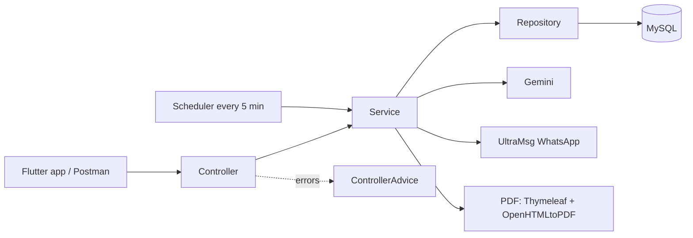
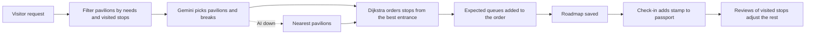
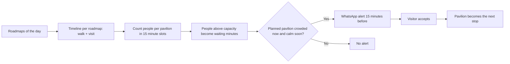
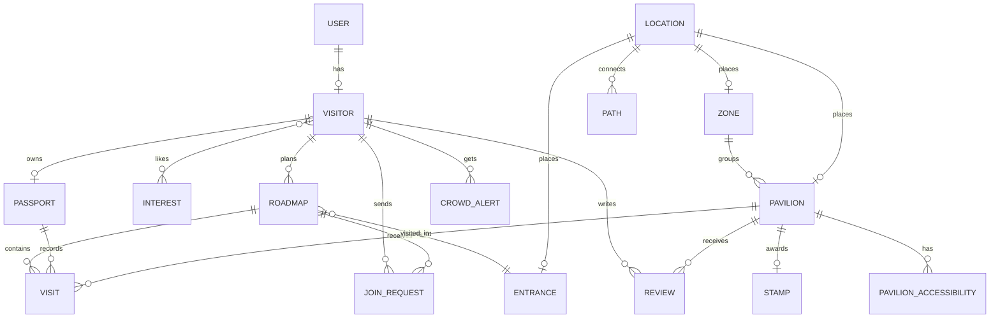

<div align="center">


# Wijha · وِجهة

**Smart visitor companion for Expo 2030 Riyadh, powered by AI**

رفيق الزائر الذكي لإكسبو 2030 الرياض: خطة يوم مخصصة، جواز بأختام، وتنبيهات ازدحام


</div>

---

Wijha (وِجهة) helps visitors of Expo 2030 Riyadh get the most out of their day. A visitor tells the app who is coming, what they like and what they need, and the AI builds a day roadmap through the pavilions. The route is ordered by real walking paths and expected queues, every pavilion visited adds a stamp to the visitor's passport, and the visitor can share the plan as a PDF or find a group to visit with.

This repository is the Spring Boot backend that serves the Flutter mobile app.

> Capstone — Web Application Development by Java (Group Project)

## 📑 Table of Contents

- [Features](#-features)
- [Tech Stack](#️-tech-stack)
- [Integrations](#-integrations)
- [Architecture](#️-architecture)
- [How the Roadmap Is Built](#-how-the-roadmap-is-built)
- [How Crowd Alerts Work](#-how-crowd-alerts-work)
- [Data Model](#️-data-model)
- [Security and Roles](#-security-and-roles)
- [Project Structure](#-project-structure)
- [Getting Started](#-getting-started)
- [Seed Data](#-seed-data)
- [API Overview](#-api-overview)
- [Team](#-team)
- [Endpoints](#-endpoints)

## ✨ Features

- **AI day roadmap**: the visitor chooses the date, party type and size, arrival and departure time, interests, pace and breaks (prayer, meals, child rest). The AI picks the pavilions and suggests breaks, then Dijkstra orders the stops. If the AI is down, the nearest pavilions are used instead.
- **Smart routing**: shortest walking path over the Expo paths, a step-free mode that avoids stairs, and a shade preference. The best entrance is chosen automatically and the visitor can change it.
- **Crowd estimate**: queue time for every pavilion now and for every 15 minutes until the end of the day, calculated from the roadmaps of all visitors. No cameras or sensors.
- **WhatsApp crowd alerts**: when a planned pavilion is crowded now and will be calm soon, the visitor gets a message and can move it to be the next stop.
- **Passport and stamps**: every visitor has a passport. Checking in at a pavilion adds that pavilion's stamp (58 pavilion stamp designs are included).
- **Accessibility**: six needs (wheelchair, limited mobility, visual, hearing, sensory, stroller and elderly). Pavilions that cannot serve the trip are removed, and the stop shows what a pavilion does not fully serve. Visitor verdicts can flag a pavilion whose official status looks wrong.
- **Reviews with AI moderation**: ratings and comments in Arabic or English. The AI rejects racist or very rude comments and still allows polite criticism.
- **Chatbot (RAG)**: answers visitor questions about the Expo from a knowledge file, in the language the visitor writes in, with ready answers for common questions.
- **Find a group**: a visitor shares their plan, others can see it, request to join, and the founder accepts or rejects. An accepted member gets a locked copy of the plan. Groups have at most 5 people. The founder chooses whether to show their phone number and whether the plan is visible to the same gender only.
- **Shareable journey PDF**: the roadmap with the route drawn on the Expo map, the stops and the stamps status. It is generated on the backend from an HTML template and can also be sent to the visitor's own WhatsApp on request.
- **Admin dashboard**: most visited and top rated pavilions, current queues, and pavilions whose accessibility status visitors disagree with.

## 🛠️ Tech Stack

| Layer | Technology |
|---|---|
| Language | Java 17 |
| Framework | Spring Boot 4.1 (Spring MVC, `RestClient`) |
| Security | Spring Security, HTTP Basic, BCrypt |
| Persistence | Spring Data JPA, Hibernate |
| Database | MySQL |
| Validation | Jakarta Validation |
| Boilerplate | Lombok |
| PDF | Thymeleaf + OpenHTMLtoPDF (with RTL and SVG support, Cairo font) |
| Scheduling | Spring `@Scheduled` for crowd alerts, `@Async` for WhatsApp |
| Mobile app | Flutter |
| Testing | Postman |
| Version control | Git & GitHub |

## 🔌 Integrations

| Service | Used for | How we integrated it |
|---|---|---|
|  **Google Gemini (generate)** | Roadmap AI, breaks, review moderation, chatbot | `GeminiService` calls the Gemini REST API through a dedicated `RestClient` with retry. JSON mode is used for roadmaps and moderation, plain text for the chatbot. If the main model fails, a fallback model is tried. |
|  **Google Gemini (embeddings)** | Chatbot search | `RagService` loads `rag-knowledge.json` (one chunk per pavilion and per topic), embeds the chunks, and finds the closest ones to the question. |
|  **UltraMsg (WhatsApp)** | Crowd alerts and PDF | `WhatsAppService` sends text messages for crowd alerts and the roadmap PDF as a document when the visitor asks for it. |
| 📐 **Dijkstra** | Routing | `PathService` finds the shortest walking path on the Expo paths, with step-free and shade options. No external API. |
| 🗺️ **Expo map** | PDF and map pages | The route is drawn on `expo-map.png` inside the PDF, and `route3d.html` shows the map in the browser. |

Every external call is wrapped so that a failure never breaks the main operation. If the AI is down, the roadmap falls back to the nearest pavilions, a review is accepted without moderation, and the chatbot answers from the closest ready answer. A failed WhatsApp message never fails the roadmap.

## 🏗️ Architecture



## 🔄 How the Roadmap Is Built



## 🚦 How Crowd Alerts Work



The scheduler checks every 5 minutes. A visitor gets at most 3 alerts a day, at least 20 minutes apart, and one alert per pavilion. Alerts are sent only for roadmaps where the visitor turned WhatsApp alerts on. An admin can set a manual queue for a pavilion (for demos or pavilion staff) and change how many real visitors one app user stands for.

## 🗄️ Data Model

| Entity | Description |
|---|---|
| `User` | Account (username, BCrypt password, email, phone, role). Role is `VISITOR` by default |
| `Visitor` | Visitor profile (age, gender, language, nationality, interests), linked to a User |
| `Passport` | One per visitor, with a generated number such as `EXPO30-000012` |
| `Stamp` | The stamp design a passport earns by visiting a pavilion |
| `Visit` | A pavilion in a passport. It is a planned stop in a roadmap until the check-in marks it visited |
| `Zone` | A zone of the Expo that groups pavilions |
| `Pavilion` | A country pavilion (capacity, average visit time, description, image) |
| `PavilionAccessibility` | Status of a pavilion for one need type, with an Arabic and English note |
| `Location` | A point on the Expo map (x, y), used by zones, pavilions and entrances |
| `Entrance` | A gate where a roadmap starts |
| `Path` | A walkway between two locations (distance, step-free, shaded) |
| `Interest` | An interest such as culture or food, with an Arabic name |
| `Roadmap` | A day plan (party, times, needs, pace, breaks, AI summary, sharing settings) |
| `JoinRequest` | A request to join a shared roadmap, with status |
| `Review` | Rating, comment and accessibility verdict for a pavilion |
| `CrowdAlert` | A WhatsApp crowd alert sent to a visitor, and whether they accepted it |



## 🔐 Security and Roles

The API uses HTTP Basic authentication with BCrypt passwords. There are two roles.

| Access | Who | Examples |
|---|---|---|
| Public | Anyone | Register, browse pavilions, zones, entrances, interests, paths, crowd now, pavilion average rating |
| `VISITOR` | A logged in visitor, own data only | Roadmaps, check-in, passport, reviews, chatbot, crowd alerts, find a group |
| `ADMIN` | Platform admin | Dashboard, manage zones, pavilions, locations, entrances, paths, interests, crowd overrides |

Visitors can only read and change their own roadmaps, reviews and account. Admin accounts are created by changing the role in the database. There is no admin sign-up endpoint.

## 📁 Project Structure

```
com.example.expo
├── Advice       # Global exception handling
├── Api          # ApiException and ApiResponse
├── Config       # Security configuration, DataSeeder
├── Controller   # REST endpoints
├── Dto
│   ├── In       # Request bodies with validation
│   └── Out      # Response bodies
├── Model        # JPA entities
├── Repository   # Database access
└── Service      # Business logic, AI, crowd, PDF, WhatsApp
```

Resources: `data/expo-data.json` (seed data), `data/rag-knowledge.json` (chatbot knowledge), `static/stamps` (stamp designs), `templates/journey.xhtml` (PDF template), `fonts` (Cairo).

## 🚀 Getting Started

1. Clone the repository:
   ```
   git clone https://github.com/FaiAlharthi/ExpoProject.git
   ```
2. Create a MySQL database named `Expo_db` and set your connection details in `src/main/resources/application.properties`.
3. Add your keys in `src/main/resources/application-local.properties` (kept out of Git), or set them as environment variables:
   ```properties
   ai.api.key=YOUR_GEMINI_KEY
   ultramsg.instance-id=YOUR_INSTANCE_ID
   ultramsg.token=YOUR_ULTRAMSG_TOKEN
   # optional: real meters per map unit, adds the distance card to the PDF
   expo.map.meters-per-unit=2.5
   ```
4. Run the application from your IDE, or with:
   ```
   ./mvnw spring-boot:run
   ```

The server starts on `http://localhost:8080`.

## 🌱 Seed Data

On first run, the `DataSeeder` fills the database from `expo-data.json`:

| Data | Count |
|---|---|
| Zones | 5 |
| Pavilions (each with a stamp) | 58 |
| Entrances | 4 |
| Paths | 137 |
| Interests | 14 |

There are no default accounts. Register a visitor with `POST /api/v1/visitor/register`. To get an admin, change that user's `role` to `ADMIN` in the database.

## 📊 API Overview

All endpoints start with `/api/v1`.

**98 endpoints in total across 15 controllers.**

| Controller | Base Path | Endpoints |
|---|---|---|
| Roadmap | `/roadmap` | 24 |
| Pavilion | `/pavilion` | 11 |
| Crowd | `/crowd` | 9 |
| Path | `/path` | 9 |
| Visitor | `/visitor` | 9 |
| Review | `/review` | 8 |
| Entrance | `/entrance` | 4 |
| Interest | `/interest` | 4 |
| Location | `/location` | 4 |
| User | `/user` | 4 |
| Zone | `/zone` | 4 |
| Passport | `/passport` | 3 |
| Chatbot | `/chatbot` | 2 |
| Visit | `/visit` | 2 |
| Admin | `/admin` | 1 |

Logout is available at `POST /api/v1/user/auth/logout`.

## 👥 Team

<table>
  <tr>
    <td align="center" width="25%">
      <a href="https://github.com/FaiAlharthi"><br><b>Fai</b></a><br><br>
      TODO: area of work
    </td>
    <td align="center" width="25%">
      <a href="https://github.com/TODO-USERNAME-2"><br><b>TODO: Name</b></a><br><br>
      TODO: area of work
    </td>
    <td align="center" width="25%">
      <a href="https://github.com/TODO-USERNAME-3"><br><b>TODO: Name</b></a><br><br>
      TODO: area of work
    </td>
    <td align="center" width="25%">
      <a href="https://github.com/TODO-USERNAME-4"><br><b>TODO: Name</b></a><br><br>
      TODO: area of work
    </td>
  </tr>
</table>

## 🧩 Endpoints

Paths are relative to `/api/v1`. Access: 🌐 public, 👤 visitor, 🛡️ admin.  = powered by Gemini.

<details open>
<summary><b>Visitors & Accounts</b> (13)</summary>

| Access | Method | Endpoint | Description |
|---|---|---|---|
| 🌐 | `POST` | `/visitor/register` | Register a new visitor account |
| 👤 | `GET` | `/visitor/getMyInfo` | My profile |
| 👤 | `PUT` | `/visitor/updateVisitor` | Update my profile |
| 👤 | `PUT` | `/visitor/addInterest/{interestId}` | Add an interest |
| 👤 | `DELETE` | `/visitor/removeInterest/{interestId}` | Remove an interest |
| 👤 | `DELETE` | `/visitor/deleteVisitor` | Delete my visitor account |
| 🛡️ | `GET` | `/visitor/getAll` | All visitors |
| 🛡️ | `GET` | `/visitor/get/{id}` | One visitor |
| 🛡️ | `DELETE` | `/visitor/deleteVisitor/{id}` | Delete a visitor |
| 👤🛡️ | `GET` | `/user/get/{id}` | Get a user account |
| 👤 | `PUT` | `/user/updateUser` | Update my account |
| 👤 | `DELETE` | `/user/deleteUser` | Delete my account |
| 🛡️ | `DELETE` | `/user/deleteUser/{id}` | Delete a user |

</details>

<details open>
<summary><b>Roadmap & Find a Group</b> (24)</summary>

| Access | Method | Endpoint | Description |
|---|---|---|---|
| 👤 | `POST` | `/roadmap/generate` |  Generate the day roadmap |
| 👤 | `GET` | `/roadmap/getMyRoadmaps` | My roadmaps |
| 👤 | `GET` | `/roadmap/getStops/{roadmapId}` | Stops of a roadmap with expected time and queue |
| 👤 | `PUT` | `/roadmap/changeEntrance/{roadmapId}/{entranceId}` | Change the start entrance and reorder the stops |
| 👤 | `POST` | `/roadmap/addStop/{roadmapId}/{pavilionId}/{position}` | Add a pavilion at a position |
| 👤 | `DELETE` | `/roadmap/removeStop/{roadmapId}/{visitId}` | Remove an unvisited stop |
| 👤 | `PUT` | `/roadmap/reorder/{roadmapId}` | Reorder the unvisited stops |
| 👤 | `PUT` | `/roadmap/makeDynamic/{roadmapId}` |  Regenerate the remaining stops from the reviews of visited ones |
| 👤 | `DELETE` | `/roadmap/deleteRoadmap/{id}` | Delete a roadmap |
| 👤 | `GET` | `/roadmap/pdf/{roadmapId}` | Download the journey as a PDF |
| 👤 | `POST` | `/roadmap/sendPdf/{roadmapId}` | Send the PDF to my WhatsApp |
| 👤 | `PUT` | `/roadmap/share/{roadmapId}` | Publish the roadmap or change its share settings |
| 👤 | `PUT` | `/roadmap/unshare/{roadmapId}` | Stop sharing |
| 👤 | `PUT` | `/roadmap/confirm/{roadmapId}` | Confirm the plan, stops become fixed |
| 👤 | `GET` | `/roadmap/shared` | Shared plans of a day, most common interests first |
| 👤 | `POST` | `/roadmap/{roadmapId}/join` | Request to join a shared plan |
| 👤 | `DELETE` | `/roadmap/join/{requestId}` | Cancel my join request |
| 👤 | `GET` | `/roadmap/myJoinRequests` | My join requests and their status |
| 👤 | `DELETE` | `/roadmap/{roadmapId}/leave` | Leave a group |
| 👤 | `GET` | `/roadmap/{roadmapId}/requests` | Join requests for my plan |
| 👤 | `PUT` | `/roadmap/requests/{requestId}/accept` | Accept a request |
| 👤 | `PUT` | `/roadmap/requests/{requestId}/reject` | Reject a request |
| 👤 | `GET` | `/roadmap/{roadmapId}/group` | Group members |
| 🛡️ | `GET` | `/roadmap/getAll` | All roadmaps |

</details>

<details open>
<summary><b>Pavilions, Zones, Entrances, Locations & Interests</b> (27)</summary>

| Access | Method | Endpoint | Description |
|---|---|---|---|
| 🌐 | `GET` | `/pavilion/get` | All pavilions |
| 🌐 | `GET` | `/pavilion/details/{pavilionId}` | Pavilion page with reviews and accessibility |
| 🌐 | `GET` | `/pavilion/zone/{zoneId}` | Pavilions in a zone |
| 🌐 | `GET` | `/pavilion/search/{name}` | Search pavilions by name |
| 🌐 | `GET` | `/pavilion/top-rated` | Top rated pavilions |
| 🌐 | `GET` | `/pavilion/accessible/{needs}` | Pavilions that serve all the needs, e.g. `WHEELCHAIR,SENSORY` |
| 👤 | `GET` | `/pavilion/unvisited` | Pavilions I have not visited |
| 🛡️ | `POST` | `/pavilion/add/{zoneId}/{locationId}` | Add a pavilion |
| 🛡️ | `PUT` | `/pavilion/update/{id}` | Update a pavilion |
| 🛡️ | `DELETE` | `/pavilion/delete/{id}` | Delete a pavilion |
| 🛡️ | `PUT` | `/pavilion/accessibility/{pavilionId}/{needType}` | Set the accessibility status for a need |
| 🌐 | `GET` | `/zone/get` | All zones |
| 🛡️ | `POST` | `/zone/add/{locationId}` | Add a zone |
| 🛡️ | `PUT` | `/zone/update/{id}` | Update a zone |
| 🛡️ | `DELETE` | `/zone/delete/{id}` | Delete a zone |
| 🌐 | `GET` | `/entrance/getAll` | All entrances |
| 🛡️ | `POST` | `/entrance/createEntrance/{locationId}` | Create an entrance |
| 🛡️ | `PUT` | `/entrance/updateEntrance/{id}` | Update an entrance |
| 🛡️ | `DELETE` | `/entrance/deleteEntrance/{id}` | Delete an entrance |
| 🌐 | `GET` | `/location/get` | All map locations |
| 🛡️ | `POST` | `/location/add` | Add a location |
| 🛡️ | `PUT` | `/location/update/{id}` | Update a location |
| 🛡️ | `DELETE` | `/location/delete/{id}` | Delete a location |
| 🌐 | `GET` | `/interest/get` | All interests |
| 🛡️ | `POST` | `/interest/add` | Add an interest |
| 🛡️ | `PUT` | `/interest/update/{id}` | Update an interest |
| 🛡️ | `DELETE` | `/interest/delete/{id}` | Delete an interest |

</details>

<details open>
<summary><b>Paths & Routing</b> (9)</summary>

| Access | Method | Endpoint | Description |
|---|---|---|---|
| 🌐 | `GET` | `/path/get` | All paths |
| 🌐 | `GET` | `/path/shortest/{fromId}/{toId}` | Shortest walking path between two locations |
| 🌐 | `GET` | `/path/shortest-accessible/{fromId}/{toId}` | Shortest path without stairs, preferring shade |
| 👤 | `GET` | `/path/roadmap/{roadmapId}` | Route of a roadmap from its entrance |
| 👤 | `GET` | `/path/roadmap/{roadmapId}/{startLocationId}` | Route of a roadmap from any point, such as where the visitor is now |
| 🛡️ | `POST` | `/path/add/{fromId}/{toId}` | Add a path |
| 🛡️ | `DELETE` | `/path/delete/{id}` | Delete a path |
| 🛡️ | `POST` | `/path/generate` | Generate paths between locations |
| 🛡️ | `PUT` | `/path/accessibility/{id}` | Mark a path as step-free or shaded |

</details>

<details open>
<summary><b>Passport, Check-in & Reviews</b> (13)</summary>

| Access | Method | Endpoint | Description |
|---|---|---|---|
| 👤 | `POST` | `/visit/checkIn/{pavilionId}` | Check in at a pavilion and earn its stamp |
| 🛡️ | `GET` | `/visit/getAll` | All visits |
| 👤 | `GET` | `/passport/getMyPassport` | My passport |
| 👤 | `GET` | `/passport/getMyStamps` | My stamps |
| 🛡️ | `GET` | `/passport/getAll` | All passports |
| 👤 | `POST` | `/review/add/{pavilionId}` |  Add a review, checked by AI moderation |
| 👤 | `PUT` | `/review/update/{reviewId}` | Update my review |
| 👤🛡️ | `DELETE` | `/review/delete/{reviewId}` | Delete a review |
| 👤 | `GET` | `/review/getMyReviews` | My reviews |
| 👤 | `GET` | `/review/getPending` | Visited pavilions I have not reviewed yet |
| 🌐 | `GET` | `/review/pavilion/{pavilionId}/average` | Average rating of a pavilion |
| 🌐 | `GET` | `/review/pavilion/{pavilionId}/latest` | Latest reviews of a pavilion |
| 🛡️ | `GET` | `/review/get` | All reviews |

</details>

<details open>
<summary><b>Crowd, Chatbot & Dashboard</b> (12)</summary>

| Access | Method | Endpoint | Description |
|---|---|---|---|
| 🌐 | `GET` | `/crowd/now` | Expected queue of every pavilion now, longest first |
| 🌐 | `GET` | `/crowd/pavilion/{pavilionId}` | Queue now and every 15 minutes until the end of the day |
| 👤 | `GET` | `/crowd/alerts/my` | WhatsApp alerts I got today |
| 👤 | `POST` | `/crowd/alerts/{alertId}/accept` | Accept an alert, the pavilion becomes the next stop |
| 🛡️ | `PUT` | `/crowd/factor/{value}` | How many visitors one app user stands for |
| 🛡️ | `PUT` | `/crowd/override/{pavilionId}/{minutes}` | Set a manual queue for the next 30 minutes |
| 🛡️ | `PUT` | `/crowd/override/{pavilionId}/{minutes}/{duration}` | Set a manual queue for a chosen duration |
| 🛡️ | `DELETE` | `/crowd/override/{pavilionId}` | Remove the manual queue |
| 🛡️ | `POST` | `/crowd/check` | Run the alert check now |
| 👤 | `GET` | `/chatbot/suggestions` |  Ready questions in my language |
| 👤 | `POST` | `/chatbot/ask` |  Ask the Expo assistant |
| 🛡️ | `GET` | `/admin/dashboard` | Platform statistics for the admin |

</details>
